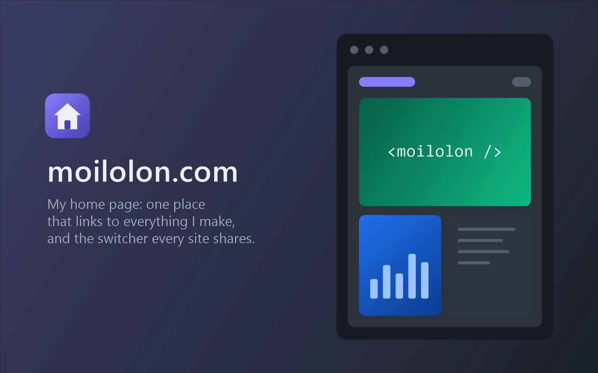

<div align="center">


# moilolon.com

**My home page: one place that links to everything I make**

[](https://moilolon.com/)

[](#-how-it-works)
[](https://vercel.com/)



</div>

---

## ✨ What this is

A single static page at the root of the domain. It is only a way in: a card per site that
lives under it.

| | Site | What it is |
|---|---|---|
| 👨🏻‍💻 | [portfolio.moilolon.com](https://portfolio.moilolon.com) | Experience, projects and a contact form |
| 📊 | [dashboard.moilolon.com](https://dashboard.moilolon.com) | Dashboards of home data |

---

## 🧭 How it works

- **No build and no dependencies.** What is on `main` is the site; Vercel serves the
  files as they are, with Web Analytics and Speed Insights.
- **Dark and light, English and Spanish.** It starts with the system's theme and the
  browser's language. Both choices are kept in two cookies of the whole domain, so a
  choice made in one site holds in the others.
- **One switcher for every site.** `nav.js` defines the `<moilolon-nav>` element, the list
  of every site under the domain. The other sites load it from here, so a new site
  reaches all of them with nothing to publish there.
- **Adding a site** is a card in `index.html`, its texts in `main.js` and its entry in
  `nav.js`.

---

## 🚀 Getting started

```bash
python -m http.server 8766
```

Then open `http://localhost:8766/`.

---

<div align="center">
<sub><a href="https://moilolon.com">moilolon.com</a> · <a href="https://github.com/moilolon">@moilolon</a></sub>
</div>
